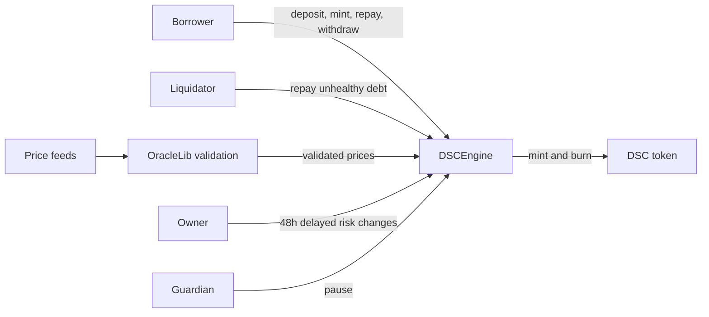

# DSC Stablecoin

**Overcollateralized stablecoin protocol · Solidity · Foundry**

[](https://github.com/imranpollob/stablecoin/actions/workflows/ci.yml)
[](foundry.toml)
[](LICENSE)

DSC is a collateral-backed stablecoin protocol with permissionless liquidation,
decimal-aware oracle pricing, explicit debt accounting, and configurable risk
controls. Users deposit collateral, mint DSC, repay debt, and withdraw collateral
subject to health-factor requirements.

The protocol includes emergency pause controls, delayed risk-parameter updates,
and a bad-debt ledger. Its verification suite combines unit tests, security
regressions, stateful invariant campaigns, and static analysis.

**Development status:** validated locally with mock assets and feeds. Independent
security review and production deployment validation remain pending.

## Protocol overview

Users deposit allowlisted collateral and mint DSC against its USD value. The
engine enforces a minimum health factor when borrowing or withdrawing collateral.
Liquidators repay unhealthy positions in exchange for collateral plus a bonus.
DSC is accounted at $1 for protocol calculations; this does not guarantee a market peg.



| Mechanism | Current implementation |
| --- | --- |
| Collateral | Fixed at construction; token and feed decimals must be ≤18 |
| Borrowing limit | Default 50% liquidation threshold and minimum health factor of `1e18` |
| Liquidation | Default 10% bonus; seizure capped at the borrower's selected collateral balance |
| Bad debt | Residual debt recorded when all collateral is exhausted; voluntary `coverBadDebt` burns DSC against it |
| Emergency pause | Blocks minting and withdrawals; deposits, repayment, and liquidation remain available, subject to their other checks |
| Administration | Two-step ownership; 48-hour delay and bounds on risk changes; separate pause-only guardian |
| Oracles | Positive price, complete round, valid timestamp, and heartbeat checks; default heartbeat is three hours |

The 48-hour delay is implemented inside the engine. Deployment does not install
a multisig or an external timelock. Risk changes apply globally to all collateral
configs. [Architecture and formulas →](docs/architecture.md)

## Security findings

The internal security review tracks the following resolved issues. Severity
labels are assigned by the maintainer; each entry links to its regression test.

| ID | Severity | Issue / hardening area | Evidence |
| --- | --- | --- | --- |
| H-01 | High | Liquidation reverts when collateral cannot fund debt plus bonus | [Test](test/poc/H01_LiquidationUnderflow.t.sol) |
| H-02 | High | Fixed decimal assumptions misprice non-18-decimal collateral | [Test](test/poc/H02_CollateralDecimals.t.sol) |
| M-01 | Medium | Pause blocks repayment and liquidation | [Test](test/poc/M01_AsymmetricPause.t.sol) |
| M-02 | Medium | Immediate, unbounded administrator risk changes | [Test](test/poc/M02_RiskTimelock.t.sol) |
| M-03 | Medium | Incomplete oracle validation | [Test](test/poc/M03_OracleValidation.t.sol) |
| M-04 | Medium | Unused stale feeds block unrelated positions | [Test](test/poc/M04_UnusedStaleFeed.t.sol) |
| L-01 | Low | Inconsistent reentrancy guards on settlement entry points | [Test](test/poc/L01_ReentrancyGuard.t.sol) |
| L-03 | Low | Duplicate collateral accepted at construction | [Test](test/poc/L03_ConstructorValidation.t.sol) |
| L-04 | Low | Nominal deposit accounting ignores transfer fees | [Test](test/poc/L04_FeeOnTransferAccounting.t.sol) |
| L-05 | Low | Single-step ownership transfer | [Test](test/poc/L05_TwoStepOwnership.t.sol) |
| L-06 | Low | Inherited `burnFrom` changes supply without settling engine debt | [Test](test/poc/L06_DirectBurn.t.sol) |
| I-01 | Informational | Health-factor precision and rounding | [Test](test/poc/I01_HealthFactorPrecision.t.sol) |

These areas are addressed in the current implementation. **L-02**, uneconomical
dust liquidation, remains open. Oracle failover, L2 sequencer handling, and an
automated recapitalization mechanism are also outside the current implementation.

## Security documentation

| Document | Contents |
| --- | --- |
| [Security review](audits/security-review-v0.md) | Findings, impact, remediation decisions, and regression evidence |
| [Accounting review](audits/review-2026-11.md) | Token burn access controls and debt-conservation verification |
| [Property specification](docs/properties.md) | Tested invariants, campaign boundaries, and coverage gaps |
| [Threat model](docs/threat-model.md) | Trust assumptions, supported token behavior, and residual risks |
| [Static analysis](audits/static-analysis.md) | Reproduced detector output and manual triage |

## Run locally

Requirements: Git, Make (optional), and **Foundry v1.8.4** (`forge`, `cast`, and
`anvil`). Solidity **0.8.19**, the Paris EVM target, and optimizer settings are
explicit in [foundry.toml](foundry.toml). Dependencies are pinned Git submodules.

```bash
git clone --recurse-submodules https://github.com/imranpollob/stablecoin.git
cd stablecoin

# For an existing clone:
git submodule update --init --recursive

forge build
forge test
make check
```

Tests require no RPC endpoint, funded wallet, or API key. Initial dependency and
compiler installation require network access.

```bash
# Security regression tests
forge test --match-path 'test/poc/*.t.sol' -vv
forge test --match-contract H01LiquidationUnderflowTest -vvvv
forge test --match-contract L06DirectBurnTest -vvv

# Longer invariant campaign (256 runs × 128 calls per campaign)
FOUNDRY_PROFILE=ci forge test --match-path 'test/fuzz/**/*.t.sol'

# Repeat a campaign with a chosen seed
forge test --match-contract StopOnRevertInvariants --fuzz-seed 0x1234

# Coverage and contract sizes
forge coverage --report summary
forge build --sizes
```

To simulate deployment without broadcasting transactions:

```bash
forge script script/DeployDSC.s.sol:DeployDSC
```

For local Anvil deployment, run `anvil` in another terminal, then `make deploy-local`.
The local script uses Anvil's public development key. The Sepolia
configuration is unverified and is not a supported deployment target.

## Verification approach

- **Unit tests:** engine behavior, token access rules, oracle validation, and administrative controls.
- **Security regressions:** targeted scenarios for each finding linked above, including collateral exhaustion and debt/supply divergence.
- **Fail-on-revert invariants:** four funded borrowers; bounded deposit, mint, repay, redeem, and transfer actions at fixed prices. Checks debt conservation, collateral custody, and borrower health.
- **Continue-on-revert invariants:** funded borrowers and a separate funded liquidator, a seeded bad-debt settlement, price shocks, and invalid requests. Checks accounting through successful and reverted transactions.
- **Static analysis:** pinned Slither run with manual triage. CI retains the JSON report and fails on High detector results; Medium and Low results remain visible for review.

Price shocks can create insolvency. The adversarial suite checks that the debt
ledger remains accurate; it does not assert that collateral always covers supply.
The [property specification](docs/properties.md) records model assumptions and gaps.

Historical tags `v0-vulnerable` and `v1-fixed` preserve earlier snapshots. Current
tests use newer interfaces and are not a drop-in differential suite for those tags.

## Development roadmap

| Priority | Next milestone |
| --- | --- |
| Liquidation boundaries | Multi-collateral exhaustion, dust rounding, and zero-quote regressions |
| Pricing properties | Fuzz supported decimal pairs and conservative conversion bounds |
| Historical comparisons | A compatible harness with recorded vulnerable/fixed results |
| Fork integration | Pinned-block tests against real collateral tokens and price feeds |
| Stateful coverage | Compose pause, delayed risk changes, oracle outages, and time advancement |
| Independent verification | Reproducible symbolic checks or a second fuzzing engine, followed by external review |

Deployment readiness also requires feed-specific heartbeat configuration,
automated bad-debt recovery, validated deployment addresses, and operational
ownership and monitoring. These milestones remain open.

## Repository layout

```text
src/          Engine, DSC token, and oracle validation library
script/       Deployment and network/mock configuration
test/unit/    Function-level behavior and access-control tests
test/poc/     Security regression scenarios
test/fuzz/    Stateful handlers and invariant campaigns
audits/       Security review reports and static-analysis evidence
docs/         Architecture, threat model, and property specification
```

[Contributing](CONTRIBUTING.md) · [Security policy](SECURITY.md)

## License

[MIT](LICENSE). Source provenance and third-party credits are documented in
[Attribution](ATTRIBUTION.md). Dependencies retain their own licenses and notices.
