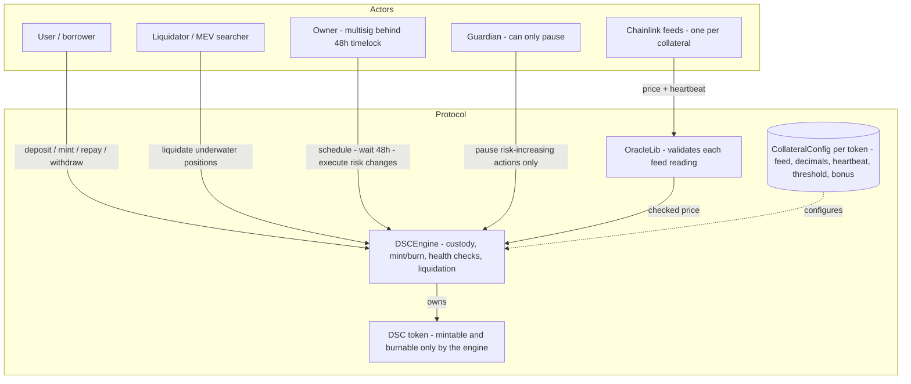
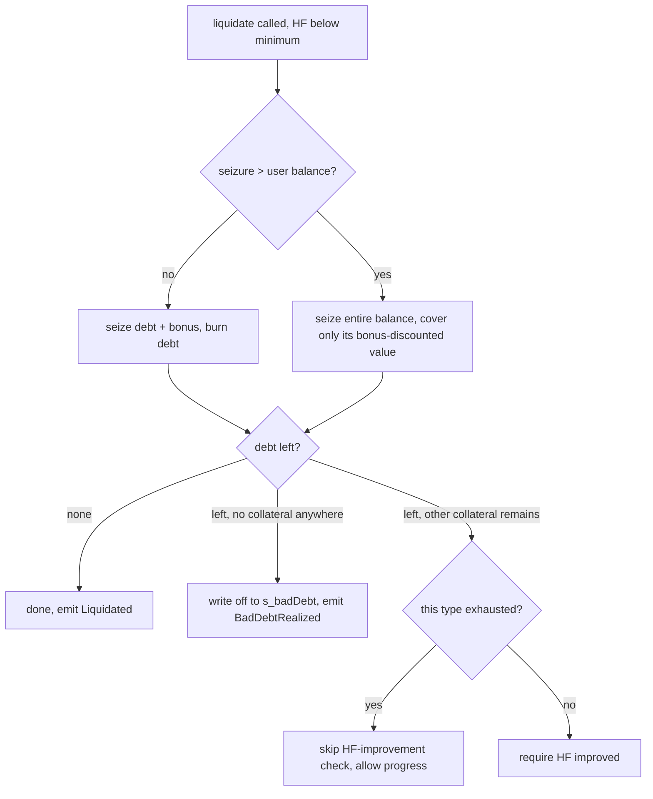
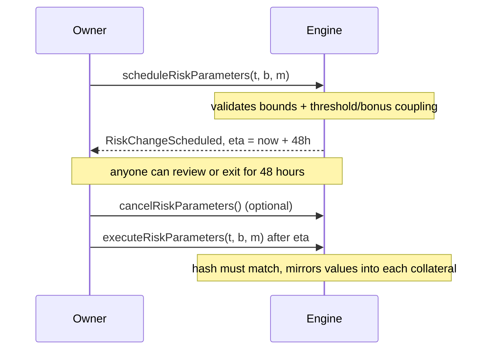
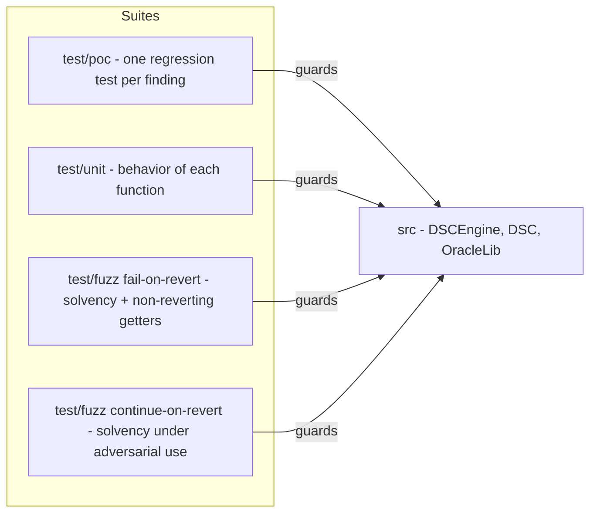

# DSC Stablecoin — my security-research case study

Hi, I'm Imran. I want to work as a blockchain security researcher, so instead
of just following another DeFi tutorial, I took a codebase I'd already studied,
broke it, audited it, and fixed it — in public. This repo is the result.

The starting point is the Cyfrin Updraft `foundry-defi-stablecoin` course
project (script headers still credit Patrick Collins). Everybody in audit
circles has seen it, which is exactly why I picked it: there is no hiding
behind unfamiliar code. My contribution is everything a reviewer is reading
right now — the hardening, the findings, and every test under `test/poc/`.

The short version of the story is in [`WORKLOG.md`](WORKLOG.md), the full
audit report in [`audits/self-audit-v0.md`](audits/self-audit-v0.md), and the
plan I worked from in [`plan.md`](plan.md).

## How the system fits together



Two design decisions worth knowing up front:

- **The pause is asymmetric.** Pausing stops minting and withdrawals, but never
  stops deposits, repayments, or liquidations. I learned the hard way (M-01)
  that a pause which traps borrowers while prices keep moving just manufactures
  bad debt.
- **Liquidation never bricks.** If collateral can't cover debt plus the bonus,
  the liquidator takes what's there and the remainder becomes explicit on-chain
  bad debt (`s_badDebt`) instead of an unliquidatable position. Somebody still
  has to recapitalize it — that's the honest part, and it's tracked as future
  work.

## What I found and fixed

| ID | Finding | Severity | Regression test |
|----|---------|----------|-----------------|
| H-01 | Liquidation reverted below (100 + bonus)% collateralization, so bad debt could never be cleared | High | [`H01_LiquidationUnderflow`](test/poc/H01_LiquidationUnderflow.t.sol) |
| H-02 | Price math assumed 18-decimal tokens and 8-decimal feeds (WBTC mispriced by 1e10) | High | [`H02_CollateralDecimals`](test/poc/H02_CollateralDecimals.t.sol) |
| M-01 | Pause trapped users and blocked liquidators | Medium | [`M01_AsymmetricPause`](test/poc/M01_AsymmetricPause.t.sol) |
| M-02 | Instant, unbounded risk-parameter changes (single-transaction rug) | Medium | [`M02_RiskTimelock`](test/poc/M02_RiskTimelock.t.sol) |
| M-03 | Oracle gaps: no `price > 0`, one global heartbeat | Medium | [`M03_OracleValidation`](test/poc/M03_OracleValidation.t.sol) |
| M-04 | One stale feed froze every user, even those not holding that token | Medium | [`M04_UnusedStaleFeed`](test/poc/M04_UnusedStaleFeed.t.sol) |
| L-01 | Two settlement paths lacked `nonReentrant` | Low | [`L01_ReentrancyGuard`](test/poc/L01_ReentrancyGuard.t.sol) |
| L-03 | Constructor accepted duplicates and zero addresses | Low | [`L03_ConstructorValidation`](test/poc/L03_ConstructorValidation.t.sol) |
| L-04 | Fee-on-transfer tokens credited by nominal amount | Low | [`L04_FeeOnTransferAccounting`](test/poc/L04_FeeOnTransferAccounting.t.sol) |
| L-05 | Single-step ownership on engine and token | Low | [`L05_TwoStepOwnership`](test/poc/L05_TwoStepOwnership.t.sol) |
| I-01 | Health-factor math must never round up | Info | [`I01_HealthFactorPrecision`](test/poc/I01_HealthFactorPrecision.t.sol) |

What I deliberately left open: no minimum-debt floor (L-02), no L2 sequencer
check, no fallback oracle. Each is documented with a reason in
[`docs/threat-model.md`](docs/threat-model.md) — I'd rather show an explicit
accepted risk than pretend the system is finished.

### The liquidation flow, after the fix



### Changing risk parameters



## How I test it



```bash
git clone --recurse-submodules <repository-url> && cd stablecoin
forge build
forge test                      # everything: unit + PoC + invariants
forge test --match-path "test/poc/*"   # just the findings, one file each
forge fmt --check && forge build --sizes
```

Tags: `v0-vulnerable` is the pre-fix baseline (every PoC fails there),
`v1-fixed` is the audited state. Slither reports zero High/Medium/Low findings
— the 20 info-level notes are each triaged in
[`audits/static-analysis.md`](audits/static-analysis.md). Properties I test are
listed in plain English in [`docs/properties.md`](docs/properties.md), and the
threat model lives in [`docs/threat-model.md`](docs/threat-model.md).

One honest footnote: while verifying a fresh clone, the invariant suite failed
once — not because of a protocol bug, but because the fuzzer picked the engine
itself as a user, turning a deposit into a zero-delta self-transfer that the
code correctly rejects. I fixed the suite with `excludeSender`, not the
protocol. The full story is in the WORKLOG; I'm keeping it here because this
is exactly the kind of thing I'd want a candidate to tell me about.

## What's next

- Mainnet-fork tests against real Chainlink feeds and real WBTC (proves H-02
  outside mocks).
- Medusa/Echidna campaign plus Halmos symbolic checks on the pricing math.
- A stability pool or insurance fund so `s_badDebt` has somewhere to go.
- The blog post: "Auditing my own stablecoin."

## License

MIT
