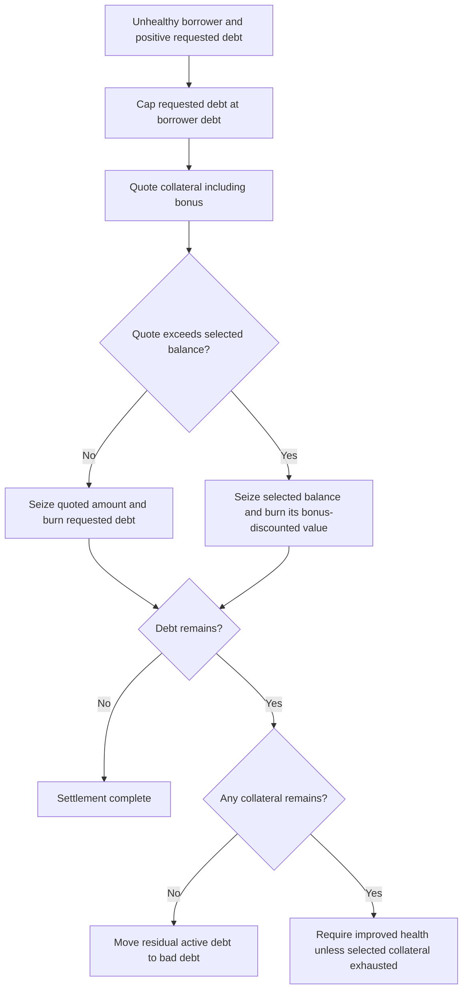

# Architecture

## Contracts and authority

| Contract | Responsibility |
| --- | --- |
| `DSCEngine` | Collateral custody, debt accounting, health checks, liquidation, emergency controls, and delayed risk updates |
| `DecentralizedStableCoin` | ERC20 debt token; `mint`, `burn`, and `burnFrom` are owner-only |
| `OracleLib` | Validates positive answers, round completeness, timestamps, and freshness |

The deployment script nominates the engine as DSC owner and calls
`acceptDscOwnership`. The engine owner is the deployer; the script does not
install a multisig. Engine ownership uses two-step acceptance. Contracts are
not upgradeable.

Collateral and feed addresses are fixed by constructor arrays. Each unique
token has a `CollateralConfig` containing its feed, heartbeat, threshold, bonus,
token/feed decimals, and enabled flag. There is no runtime `addCollateral`
function or heartbeat setter. Every config starts with a three-hour heartbeat.

## Units and health factor

Token balances use each collateral's native units. Debt, USD values, and health
factors use 18-decimal fixed-point units. Token/feed decimals above 18 are rejected.
With integer division rounded down:

```text
normalizedPrice = floor(answer × 1e18 / 10^feedDecimals)
usdValue        = floor(tokenAmount × normalizedPrice / 10^tokenDecimals)
adjustedValue   = Σ floor(usdValue[token] × threshold[token] / 100)
healthFactor    = floor(adjustedValue × 1e18 / userDebt)
```

Zero-debt accounts return `type(uint256).max` from `getHealthFactor`. Minting
and collateral withdrawal must leave the account at or above the configured
minimum. The defaults are a 50% threshold and a minimum factor of `1e18`.
`calculateHealthFactor(debt, value)` is a legacy helper using the **default**
threshold; `getHealthFactor(user)` uses current collateral configs.

`Math.mulDiv` avoids overflowing intermediate products in the principal pricing
and ratio calculations. Integer conversion still introduces rounding; token/USD
round trips are not exact for every amount and price.

## Liquidation and bad debt



The liquidator supplies DSC and receives collateral. A quote covering zero debt
or seizing zero collateral reverts. The liquidator must also pass its own final
health-factor check. A stale feed for collateral held by the borrower can block
valuation and settlement.

Exhausting one collateral type permits progress without a health-factor
improvement check. Exhausting **all** collateral moves residual borrower debt
from active debt to `s_badDebt`; this does not burn the residual DSC supply.

```text
totalAccountedDebt = totalActiveDebt + badDebt
```

Anyone holding DSC can approve the engine and call `coverBadDebt`. The engine
burns that DSC and reduces bad debt by the same amount. There is no automatic
insurance source or collateral recovery for that voluntary payment.

This flow addresses the demonstrated debt-plus-bonus underflow scenario. It
does not guarantee liquidation under dust, oracle failure, unavailable DSC,
malicious token behavior, or uneconomic execution conditions.

## Emergency controls

| Operation | Available while paused? |
| --- | --- |
| Deposit collateral | Yes |
| Repay via `burnDsc` | Yes |
| Liquidate / cover bad debt | Yes |
| Mint DSC | No |
| Redeem collateral / combined burn-and-redeem | No |

Other validation still applies. Combined deposit-and-mint reverts atomically
while paused. To repay during a pause, use `burnDsc` separately. Owner or guardian
can pause; only the owner can unpause. A zero guardian disables that role.

## Delayed risk changes

The owner schedules a hash of `(threshold, bonus, minHealthFactor)`. Execution
requires the same tuple and at least 48 hours. The owner can cancel or replace
the pending change; replacement starts a new delay.

Bounds are threshold `[10, 80]`, bonus `[0, 20]`, and minimum health factor
`[1e18, 2e18]`, with `threshold × (100 + bonus) < 10000`. Execution copies the
threshold and bonus into every collateral config. This check constrains the
parameter relationship; it does not guarantee liquidator profitability after gas.
Guardian changes, pause/unpause, and ownership operations do not use this delay.
